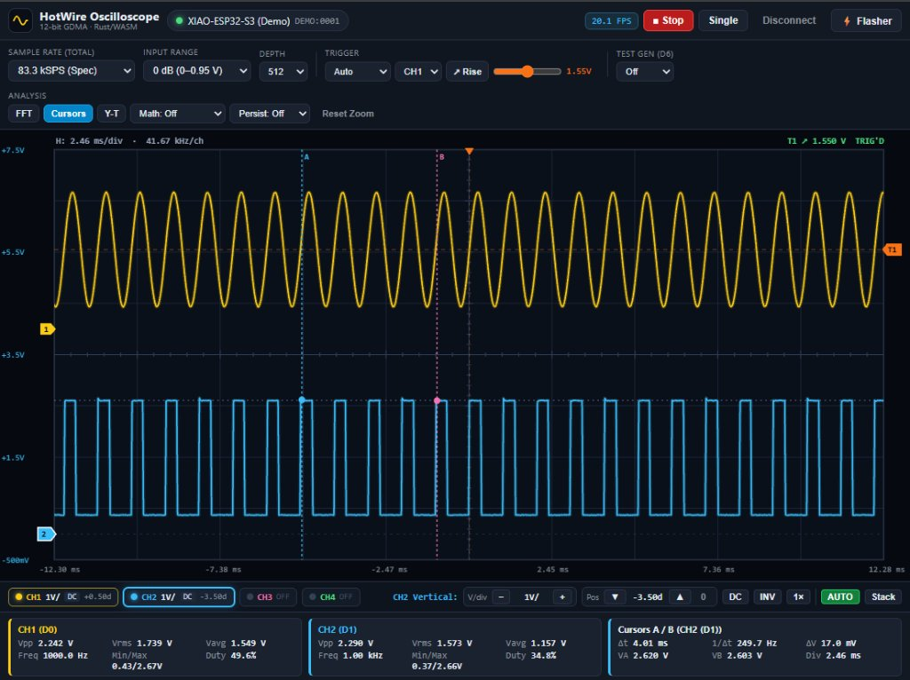

# HotWire Oscilloscope — 4-Channel 12-bit GDMA ADC Scope & FFT

[](https://github.com/kavierim/HotWire-Oscilloscope/actions/workflows/deploy.yml)
[](https://kavierim.github.io/HotWire-Oscilloscope/)
[](https://www.seeedstudio.com/XIAO-ESP32S3-p-5627.html)
[](https://developer.mozilla.org/en-US/docs/Web/API/Web_Serial_API)
[](https://leptos.dev/)

Turn a **Seeed Studio XIAO ESP32-S3** or **XIAO ESP32-C6** into a real-time **4-Channel 12-bit Digital Storage Oscilloscope (DSO)** and **FFT Spectrum Analyzer** directly in your browser — **zero drivers, zero desktop install**.

> **Try it in 1 click (no hardware required):** Open **[https://kavierim.github.io/HotWire-Oscilloscope/](https://kavierim.github.io/HotWire-Oscilloscope/)** and click **Demo** to explore the built-in 4-channel signal generator with live triggering, cursors, FFT, and persistence.



## Quick Start (XIAO ESP32-S3 / XIAO ESP32-C6)

1. Plug your **Seeed Studio XIAO ESP32-S3** or **XIAO ESP32-C6** into USB.
2. Open **[https://kavierim.github.io/HotWire-Oscilloscope/](https://kavierim.github.io/HotWire-Oscilloscope/)** in **Chrome**, **Edge**, or **Opera** (Desktop or Android).
3. Click **⚡ Flasher** (top right), select your board (`XIAO ESP32-S3` or `XIAO ESP32-C6`), and click **Flash Firmware** to program the bundled firmware (`v1.0.0+`) directly from your browser via **`esptool-js`**.
   * If a board running another HotWire firmware (e.g., Logic Analyzer or SDR) or an outdated version is connected, the app automatically disconnects and shows a one-click **Flash Firmware** prompt.
4. Connect a jumper wire from **`D6`** (built-in test generator) to **`D0`**, set **Test Gen (`D6`)** to `1 kHz` / `5 kHz` / `10 kHz` / `50 kHz`, and click **AUTO**!

## Supported Boards

| Board | Channels | Spec Rate (Calibrated) | Turbo / Overclock Modes | Test Gen Pin |
| :--- | :--- | :--- | :--- | :--- |
| **Seeed Studio XIAO ESP32-S3** | **4 ch** (`D0`–`D3` / `GPIO1–4`) | `10` / `20` / `50` / `83.3 kSPS` | `200 kSPS` (Turbo), `500 kSPS` (OC), `1 MSPS` (OC Max) | `D6` (`GPIO43`) |
| **Seeed Studio XIAO ESP32-C6** | **3 ch** (`D0`–`D2` / `GPIO0–2`) | `10` / `20` / `50` / `83.3 kSPS` | Capped at `83.3 kSPS` hardware limit | `D6` (`GPIO16`) |

## Benchtop Oscilloscope Features

- **Unified HotWire Shell (`hotwire-core`):**
  - Top toolbar with instant **Logic / Scope / SDR / Serial** tool switcher, automatic `0x83` target software & version verification (`v1.0.0+`), swipeable mobile **BottomSheet** Web Flasher, and Web Serial (Desktop) / WebUSB (Android) auto-reconnect.
- **Authentic 10×8 Graticule & Digital Phosphor:**
  - 10×8 division grid with 5-subdivision center crosshair ticks, two-pass phosphor glow, smooth monotone cubic Hermite spline interpolation when zoomed in (`>= 4 px/sample`) with sample dots (`>= 10 px/sample`), cursor-anchored mouse wheel zoom, and two-finger touch pinch-to-zoom / pan (`PinchPanTracker`).
- **Independent Per-Channel Vertical Controls (`ChannelStrip`):**
  - **Draggable Ground Markers (`1►`–`4►`):** Drag any channel's left-margin tag vertically (`−4.0` to `+4.0 div`) to position traces anywhere on screen; double-click to center (`0.0 div`); scroll mouse wheel in the left margin to step `V/div`.
  - **1-2-5 `V/div` Scaling:** `20 mV/div` up to `5 V/div` (or `200 mV/div` to `50 V/div` with `10×` probe).
  - **`DC` / `AC` Coupling, `INV` (Invert), `1×` / `10×` Probe Multiplier:** Software AC-coupling removes DC bias so you can inspect small ripple at high sensitivity.
  - **`AUTO` (Auto-Set) & `Stack`:** One-click `AUTO` picks optimal 1-2-5 `V/div`, stacks active channels into non-overlapping lanes, and centers the trigger threshold.
- **Hardware-Assisted Triggering:**
  - `Auto`, `Normal`, `Free Run`, and `Single` shot modes on `CH1`–`CH4` with Rising (`↗`) / Falling (`↘`) edge detection and Schmitt hysteresis (`±15 mV`).
  - **Draggable Trigger Handle (`T1◄`–`T4◄`):** Drag on the right edge of the graticule to adjust the hardware trigger level live.
- **Persistence / Afterglow (`Persist`):**
  - Decaying afterglow (`0.5 s`, `2 s`, `5 s`) and **Infinite (`∞`)** offscreen phosphor accumulation + `Clear` button to catch glitches, jitter, and signal envelopes.
- **Analysis & Measurements:**
  - **Live Radix-2 FFT Spectrum:** Cached Hann-windowed `dBV` spectrum pane with automatic peak frequency & amplitude readout.
  - **Math Channel (`CH1 − CH2`, `CH1 + CH2`)** and **`Y-T` / `X-Y` (Lissajous)** display mode.
  - **Draggable `A` / `B` Cursors:** Displays `Δt`, `1/Δt`, `VA`, `VB`, and `ΔV` with live intersection dots on the waveform.
  - **Automated Measurements:** Zero-allocation streaming `Vpp`, `Vrms`, `Vavg`, `Min/Max`, `Freq`, and `Duty %` per channel.

## High-Speed ADC & Capture Architecture

1. **GDMA Continuous Streaming (`esp_adc/adc_continuous.h`):** Streams 12-bit ADC1 samples directly into internal SRAM circular buffers with zero CPU polling overhead. Wi-Fi/BLE stay off to eliminate RF switching noise.
2. **O(1) eFuse Curve-Fitting LUT:** Precomputes a 4096-entry `raw -> mV` lookup table in SRAM via `adc_cali_create_scheme_curve_fitting()` for instant calibrated millivolt conversion.
3. **12-bit Packed USB CDC Protocol (`0xAA 0x55`):** Packs two 12-bit samples into 3 bytes (`-25%` USB bandwidth) directly from the per-channel ring buffers, saving ~40 KB SRAM on ESP32-S3.
4. **Dual-Core Separation (ESP32-S3):** **Core 0** runs the dedicated USB CDC command demuxer (`protocol_rx_task`), while **Core 1** runs continuous GDMA acquisition and edge triggering (`scope_capture_task`).
5. **Turbo / Overclock Modes (ESP32-S3):**
   - `83.3 kSPS (Spec)`: Official `SOC_ADC_SAMPLE_FREQ_THRES_HIGH` with full 12-bit linearity.
   - `200 kSPS (Turbo)`: Tunes `APB_SARADC.ctrl2.timer_target = 25` (`5 MHz / 25 cycles`).
   - `500 kSPS (OC)` / `1 MSPS (OC Max)`: Overclocks `APB_SARADC.ctrl.sar_clk_div` (`4` / `2`) and `timer_target` (`10` / `5`) for fast digital/PWM edge capture (trades settling accuracy for speed).

## Pinout & Input Safety (0 – 3.3 V)

| Channel | XIAO Pin | XIAO ESP32-S3 | XIAO ESP32-C6 |
| :--- | :--- | :--- | :--- |
| **CH1** | `D0 / A0` | `GPIO1` (`ADC1_CH0`) | `GPIO0` (`ADC1_CH0`) |
| **CH2** | `D1 / A1` | `GPIO2` (`ADC1_CH1`) | `GPIO1` (`ADC1_CH1`) |
| **CH3** | `D2 / A2` | `GPIO3` (`ADC1_CH2`) | `GPIO2` (`ADC1_CH2`) |
| **CH4** | `D3 / A3` | `GPIO4` (`ADC1_CH3`) | *N/A (3-ch max)* |
| **Test Gen** | `D6` | `GPIO43` (LEDC PWM) | `GPIO16` (LEDC PWM) |

> **Warning:** Never apply voltages above **3.3 V** or negative voltages directly to XIAO ADC pins. Use a 10:1 resistive divider or AC-coupling bias network for higher or bipolar signals.

## HotWire Ecosystem

- **[`hotwire-core`](https://github.com/kavierim/hotwire-core)** — Shared Rust/WASM hardware transport, framing, firmware verification, Web Flasher & UI shell
- **[HotWire Oscilloscope](https://github.com/kavierim/HotWire-Oscilloscope)** ([Live App](https://kavierim.github.io/HotWire-Oscilloscope/)) — 4-Channel 12-bit GDMA ADC Oscilloscope & FFT Spectrum Analyzer
- **[HotWire Logic Analyzer](https://github.com/kavierim/HotWire-Logic-Analyzer)** ([Live App](https://kavierim.github.io/HotWire-Logic-Analyzer/)) — 8-Channel Logic Analyzer & Tri-State Force I/O with UART/SPI/I²C decoders
- **[HotWire SDR](https://github.com/kavierim/HotWire-SDR)** ([Live App](https://kavierim.github.io/HotWire-SDR/)) — 1.84–2.79 GHz RF Spectrum Analyzer, Wideband Scanner & Waterfall
- **[HotWire Serial Terminal](https://github.com/kavierim/HotWire-Serial-Terminal)** ([Live App](https://kavierim.github.io/HotWire-Serial-Terminal/)) — Cross-platform Web Serial & WebUSB terminal for desktop and Android

## Development & Firmware

Built with **Rust + WebAssembly** ([Leptos](https://leptos.dev/) CSR + [Trunk](https://trunkrs.dev/) + `hotwire-core`).

```bash
rustup target add wasm32-unknown-unknown
cargo clippy --all-targets -- -D warnings
cargo test
trunk serve          # local dev server (http://127.0.0.1:8081)
trunk build --release
```

- **XIAO ESP32-S3 Sketch:** [`firmware/HotWire_Scope_XIAO_ESP32S3/HotWire_Scope_XIAO_ESP32S3.ino`](firmware/HotWire_Scope_XIAO_ESP32S3/HotWire_Scope_XIAO_ESP32S3.ino)
  - FQBN: `esp32:esp32:XIAO_ESP32S3:USBMode=hwcdc,CDCOnBoot=default,PSRAM=opi`
- **XIAO ESP32-C6 Sketch:** [`firmware/HotWire_Scope_XIAO_ESP32C6/HotWire_Scope_XIAO_ESP32C6.ino`](firmware/HotWire_Scope_XIAO_ESP32C6/HotWire_Scope_XIAO_ESP32C6.ino)
  - FQBN: `esp32:esp32:XIAO_ESP32C6`
- Compiled binaries for both boards are bundled in [`public/firmware/`](public/firmware/) for zero-install Web Flasher deployment.

## License

Copyright © 2026 Kari Vierimaa, Kempele — Licensed under the [Apache License 2.0](LICENSE).
